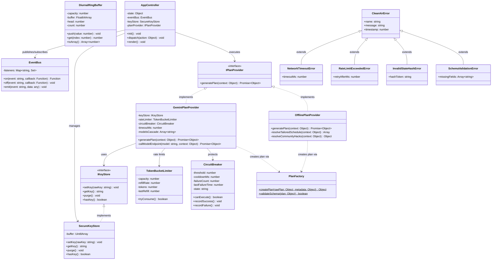

> Design record. Parts of this document describe components that were removed or replaced in version 1.3.0, such as the application controller class, the reducer, the time engine, the signals and error modules and the fixed protection efficiency. The source code is authoritative.

<!-- Generated by pipeline Step 13 — do not edit manually -->

